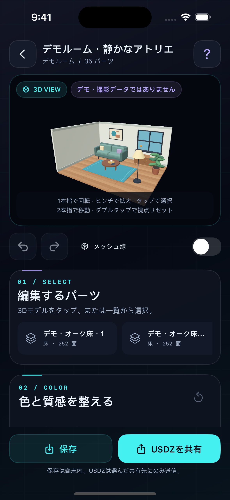

# QUESTSCAN

Swift Playgrounds向けの、空間スキャン・写真テクスチャ投影・3Dカラー編集アプリです。外部サービスや外部Swiftパッケージを使わず、SwiftUI／ARKit／RealityKit／Core Image／Foundationで動作します。アプリのソースは **[QUESTSCAN.swiftpm](QUESTSCAN.swiftpm)** です。

## 開く・実行する

**[Swift Playgrounds用パッケージをダウンロード](Dist/QUESTSCAN.swiftpm.zip)**。ZIPを展開し、`QUESTSCAN.swiftpm` を開いてください。[SHA-256](Dist/SHA256SUMS.txt)も用意しています。

このリポジトリを取得し、`QUESTSCAN.swiftpm` フォルダの名前と内部構成を保持したまま、Swift Playgroundsで開いて実行します。`Package.swift` 単体ではなくパッケージ全体を開いてください。iOS／iPadOS 16以降の実機向けです。Macで編集する場合も、ARスキャンの動作確認には対応するiPad／iPhoneを使用します。iPhoneへのインストールにはXcodeと個人の署名設定が必要です。

まずホームから「デモルーム」を開くと、カメラ権限なしで、床・ソファ・テーブル・窓・植物を備えた手続き生成ルームを編集できます。デモには撮影結果と紛らわしい架空のスキャン統計を使っていません。

詳しいインストールと操作は **[利用ガイド](Docs/UserGuide.md)**、内部構成は **[アーキテクチャ](Docs/Architecture.md)** を参照してください。

設定画面はiPhone／iPadに合わせてレイアウトされ、撮影感度や写真上限、画像品質・形状精度を調整できます。 [iPhone](Docs/Screenshots/iphone-settings.png) / [iPad](Docs/Screenshots/ipad-settings.png) の実際のシミュレータ画面。

## 実装した機能

LiDAR対応端末では、ARKitの実メッシュを取得し、対応時には床・壁・天井・テーブル・椅子等の分類を保持します。設定画面では、自動撮影感度、写真上限（最大1,000枚）、写真解像度とJPEG画質、形状の面数上限、ワイヤーフレームを選び、端末に保存できます。1,000枚モードでは各画像を最大640px・180KB、LiDAR深度を64pxへ抑えて撮影データを保持し、処理負荷を抑えるため3D投影には最大128枚を均等選択します。一時停止・再開、手動撮影、バックグラウンド時の休止、カメラ権限拒否時の案内も実装しています。

撮影画像とカメラの内部パラメータ・位置姿勢から、三角形ごとに適切な写真を選択して投影します。利用できる場合はLiDAR深度も遮蔽判定に使います。写真のない面は形状として保持します。3Dプレビューでは回転・ズーム・視点移動・タップ選択ができ、部分メッシュの色、着色強度、明るさ、コントラスト、彩度を変更できます。Undo／Redo、リセット、ワイヤー表示にも対応します。

生成したモデルは端末内へ自動保存し、保存一覧から再編集できます。USDZ書き出しでは、形状・法線・UV・マテリアル・編集済みJPEGをひとつにまとめ、iOSの共有シートへ渡します。USDZは非圧縮ZIPの64バイトアラインメント、CRC32、USDPreviewSurface、パッケージ内テクスチャ参照を実装した自己完結型です。

## 端末と品質について

非LiDAR端末では、検出した平面を取得する**平面スキャン**として動作します。家具を含む完全な立体復元ではありません。AR非対応端末やシミュレータではデモを利用してください。

写真カバー率は、検出済みの面に写真が適合する割合であり、部屋全体の完成率ではありません。選択対象はアンカー・分類・使用写真ごとの部分メッシュで、家具の完全なAIインスタンス分割ではありません。写真の継ぎ目、深度のない画像の遮蔽、鏡・ガラス・暗所、計測精度には限界があります。

端末負荷を抑えるため、写真の撮影上限は最大1,000枚ですが、高枚数モードではデータサイズを制限して3D投影には均等選択した最大128枚を使います。保持メッシュは最大60,000面・64アンカー、投影対象は最大48アンカー、出力は最大512部分です。取得時には1アンカーあたり5,000面の上限もあります。必要な間引き・省略や未投影への切り替えは説明を表示します。1,000枚近く撮る場合は長時間スキャンとなるため、広い場所は小さな範囲へ分けてください。

## プライバシー・保存

画像・深度・モデルは端末内で処理・保存します。アプリ自身によるクラウド送信・広告・アナリティクス・会員登録はありません。共有は利用者の明示的な操作によって行います。

ネイティブプロジェクトは `Documents/QUESTSCAN/*.questscan` に保存されます。アプリ削除前に必要なデータを別の場所へバックアップしてください。USDZは閲覧用で、Undo履歴や編集プロジェクトの代替ではありません。

## 検証

[GitHub Actions](https://github.com/akeyy1010/QUESTSCAN/actions/workflows/swift-validation.yml) で、AppleのiOS SDKを使用した全ソースのコンパイル・リンク、プロパティリスト検査、ZIP／USDシーン／端末内保存テスト、デモ形状／カメラ投影／深度／上限テストを実行します。Linuxの構文チェックだけでビルド済みと表現しません。

テスト範囲と実行結果は **[検証記録](Docs/Validation.md)** に記載します。カメラ・LiDAR・GPU描画・Swift Playgroundsでの実行・Quick Lookの実機確認は **[実機テスト項目](Docs/DeviceTestChecklist.md)** に分けています。SDKでコンパイルできることは、実機テストやApp Store提出の完了を意味しません。

元の計画書は [OriginalSpecification.md](Docs/OriginalSpecification.md)、API参照は [APISources.md](Docs/APISources.md)、画像投影の参照は [ProcessingAPIReferences.md](Docs/ProcessingAPIReferences.md)、USDZの参照は [ExportSourceNotes.md](Docs/ExportSourceNotes.md) です。
